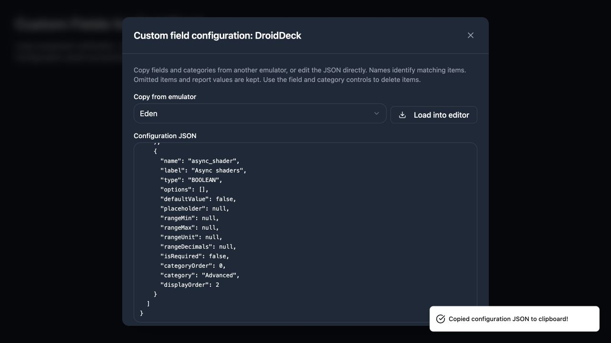

# Editing custom field configurations as JSON

Open an emulator’s custom fields page and choose **Edit JSON**. Paste a setup or edit the current JSON to change fields, attributes, categories/groups, and ordering. Choose **Save JSON** and confirm the named emulator.



## Save behavior

- The JSON represents the complete configuration. Omitted unused fields and categories are removed.
- Existing IDs identify fields/categories during edits and renames. Keep those IDs when renaming items.
- Names can be swapped between existing fields or categories in one save.
- Pasted items without a matching destination ID are matched by name or created with fresh IDs. IDs from another emulator are never used to modify its records.
- Field IDs and existing Handheld/PC Report values are preserved when updating or renaming fields.
- Removing fields with report values is blocked. Incompatible type changes, removed select options, and narrower ranges are also blocked for populated fields.
- Adding options and widening ranges are supported. Closing an unsaved draft requires confirmation.
- Concurrent edits return a conflict instead of overwriting a newer configuration. Copy the draft, reopen the editor, and reconcile it with the current configuration.

Categories include empty groups. `displayOrder` controls category/global field order; `categoryOrder` controls order within a category. A field’s `category` refers to its category name, or `null` for no category. Update that reference when renaming a category.

## JSON format

```json
{
  "version": 1,
  "categories": [
    { "name": "Graphics", "displayOrder": 0 }
  ],
  "fields": [
    {
      "name": "renderer",
      "label": "Graphics API",
      "type": "SELECT",
      "category": "Graphics",
      "options": [
        { "value": "vulkan", "label": "Vulkan" },
        { "value": "opengl", "label": "OpenGL" }
      ],
      "defaultValue": "vulkan",
      "isRequired": false,
      "displayOrder": 0,
      "categoryOrder": 0
    }
  ]
}
```

The editor includes an `id` for each existing field and category. New items may omit it. Range fields use `rangeMin`, `rangeMax`, `rangeUnit`, and `rangeDecimals`. Text/URL fields may use `placeholder`. Boolean and numeric defaults retain their JSON types, including `false` and `0`. Unknown properties, duplicate names/IDs/options, ambiguous matches, dangling categories, invalid defaults, and invalid ranges are rejected.

Persisted object/array defaults are exported as `null`, matching the existing field form. Placeholders on non-text fields are omitted as `null`; new JSON permits placeholders only on Text, Textarea and URL fields.

## Implementation and verification

The feature lives under `src/features/emulators/custom-field-config/`. Shared Zod contracts define the format. The tRPC router exposes `customFieldConfigs.get` and `save`, with explicit output schemas. Services enforce permissions, destination identity, revision checks, and report-value compatibility. The Prisma repository owns persistence and saves the entire operation in a serializable transaction.

Users need `MANAGE_CUSTOM_FIELDS`. Moderators and higher roles may manage all destinations; other users with that permission must be verified developers of the destination emulator.

Tests cover the real tRPC contract, authenticated actor, destination access, stale revisions, stable IDs during renames, pasted configurations, grouping/order, guarded removals, and compatibility for both Handheld and PC Report values. React tests cover pasting, validation, confirmation, conflicts, unsaved drafts, Escape behavior and fresh snapshot loading.

Browser verification used actual project components/styles with an isolated in-memory transport. It covered direct field/category edits, malformed JSON, save confirmation, clipboard export, and a 390 px layout. It did not write to a database or change production. No migration or seed is required.

[Phone layout](images/custom-field-config-mobile.jpg)
